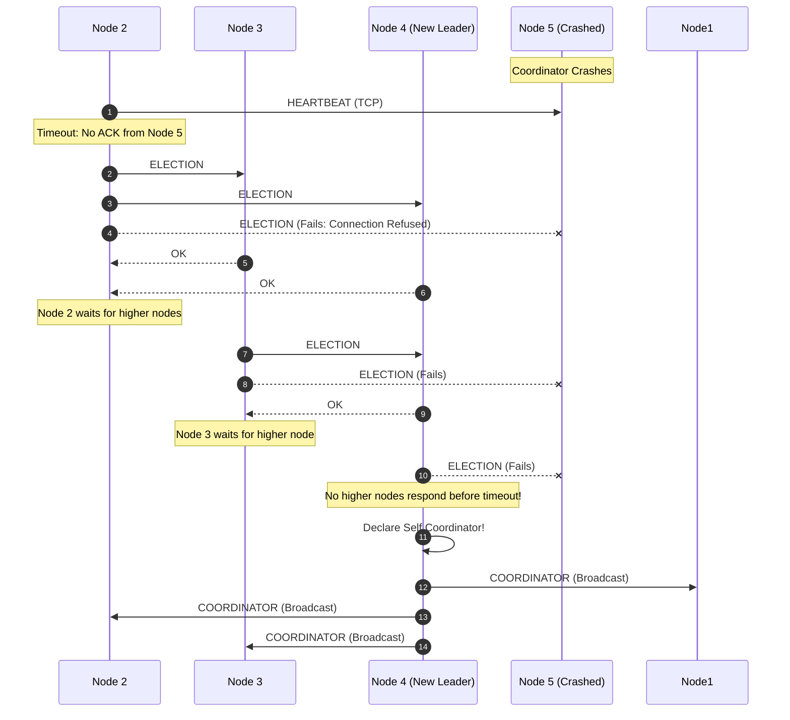

# Bully Leader Election Algorithm

## Parallel and Distributed Systems Mini-Project

This document provides a theoretical and practical explanation of the **Bully Algorithm** implemented in this project.

---

## 1. Algorithm Overview

The **Bully Algorithm** (Garcia-Molina, 1982) is a classic leader election algorithm designed for synchronous or partially synchronous distributed systems where:
- Every node has a unique, totally ordered integer identifier ($1, 2, \dots, N$).
- Nodes know the identifiers and network addresses of all other nodes in the system.
- The node with the **highest active identifier** among reachable nodes is elected coordinator.

The algorithm is called "Bully" because nodes with higher identifiers assert dominance over nodes with lower identifiers.

---

## 2. Message Types

| Message Type | Purpose | Sent By | Sent To |
| :--- | :--- | :--- | :--- |
| `ELECTION` | Announces election initiation | Any active node | Nodes with higher IDs ($P_j > P_i$) |
| `OK` | Acknowledges receipt of election and takes over | Higher-ID node | Lower-ID initiating node |
| `COORDINATOR` | Victory announcement establishing new leader | Winning node | All reachable nodes in network |
| `HEARTBEAT` | Periodic liveness probe | Non-coordinator nodes | Current coordinator |
| `HEARTBEAT_ACK` | Proof of liveness response | Current coordinator | Requesting non-coordinator |

---

## 3. Step-by-Step Election Procedure

1. **Failure Suspicion / Trigger**:
   - A non-coordinator detects that the coordinator has stopped responding to periodic heartbeats (or receives an administrative failure signal).
2. **Sending Election Messages**:
   - The detecting node $P_i$ sends an `ELECTION` message to all nodes $P_j$ where $j > i$.
3. **Handling Election Messages**:
   - If no node $P_j$ ($j > i$) responds within the configured timeout, $P_i$ wins the election and declares itself coordinator.
   - If any higher node $P_j$ is alive, it responds with an `OK` message. This indicates that $P_j$ will take over the election.
   - Upon receiving an `ELECTION` message, $P_j$ starts its own election round if it has not already done so.
4. **Victory Declaration**:
   - The winning node (highest active ID) broadcasts a `COORDINATOR` victory message to all lower peers.
   - All recipients update their local state: `coordinator_id = new_winner`.

---

## 4. Concurrent Election Handling & Stale Messages

### Concurrent Elections
If multiple lower nodes detect coordinator failure simultaneously, both initiate elections. Because both send `ELECTION` messages to higher nodes, the higher nodes respond with `OK` to both and ascend the ladder until the single highest active node declares victory.

### Stale Message Rejection
To prevent delayed or out-of-order messages from disrupting state:
- Each election run assigns an incremented `generation` counter and a unique `election_id`.
- If an active node with ID 4 receives a `COORDINATOR` claim from a lower node (e.g. Node 2), it rejects the claim and immediately asserts its own election.

---

## 5. Distributed Systems Limitations & Considerations

In theoretical models, failure detection is often assumed to be crash-stop. In practical networked systems:
1. **Network Delays vs. Node Crashes**: A network timeout does not prove a node has permanently crashed; it may be experiencing temporary latency or garbage collection.
2. **Network Partitions (Split-Brain)**: If the network partitions into disjoint components, each partition with an active node may elect its own local coordinator.
3. **Message Complexity**: In the worst-case scenario (e.g. the lowest node initiates), the Bully Algorithm requires $O(N^2)$ message exchanges.
